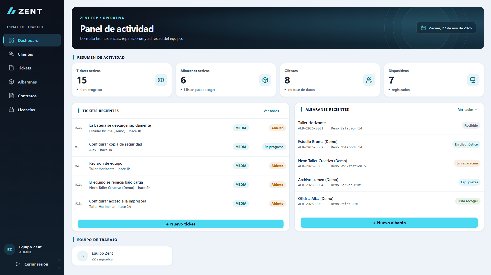
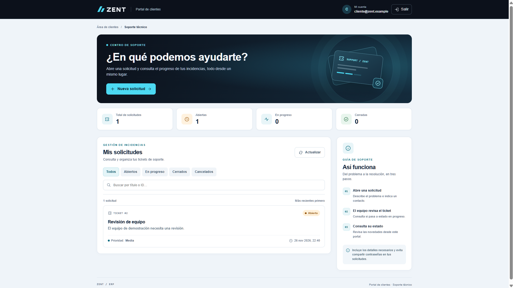
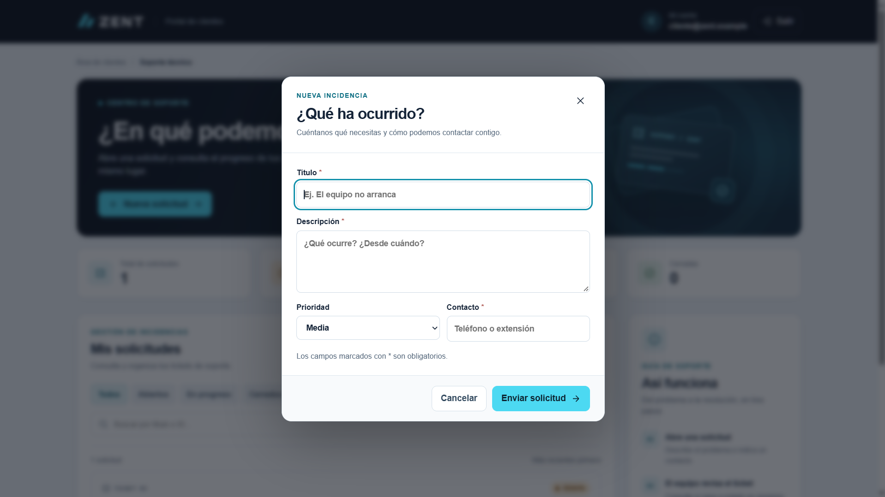
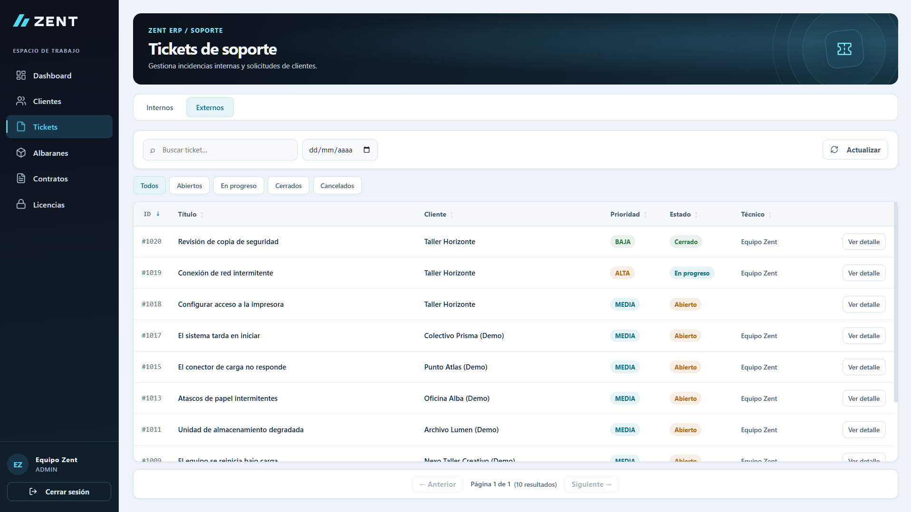
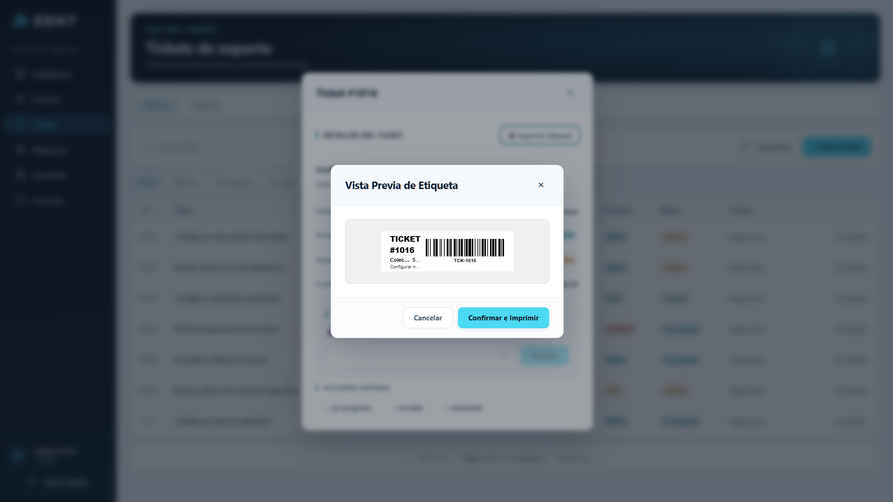
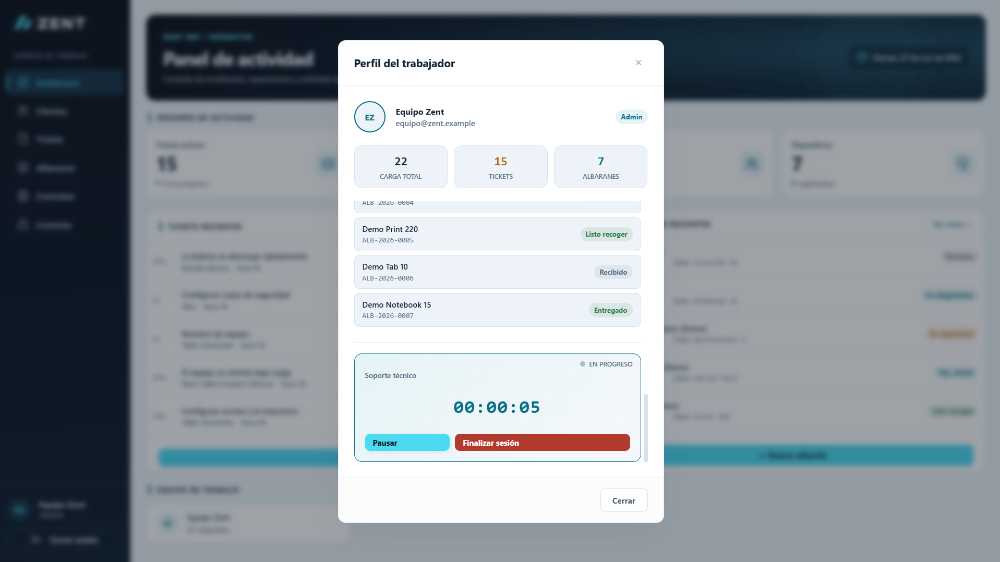
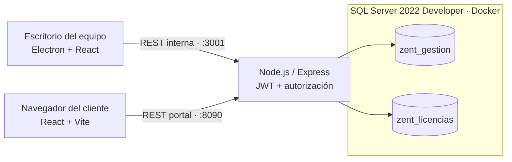

<p align="right"><a href="README.md">EN</a> · <b>ES</b></p>
<picture>
  <source media="(prefers-color-scheme: dark)" srcset="docs/readme/generated/header-es-dark.svg">
  
</picture>

**Un espacio de trabajo de escritorio para talleres informáticos, conectado a un portal de soporte para clientes.** Gestiona dispositivos, reparaciones, incidencias, contratos e inventario de software desde un mismo sistema.

[Explorar la galería](docs/gallery.es.md) · [Instalación local](#06--instalación-local) · [Evaluación de seguridad](docs/security/assessment.md) · [Zent Web](https://github.com/ArnauAlemanyDev/Zent-Web)



<picture>
  <source media="(prefers-color-scheme: dark)" srcset="docs/readme/generated/metrics-es-dark.svg">
  
</picture>

## 01 / Contexto del proyecto

Desarrollé la aplicación original durante mis prácticas del ciclo de Desarrollo de Aplicaciones Multiplataforma (DAM), para responder a necesidades diarias observadas en un taller de servicios informáticos. Seguir un ordenador desde su recepción hasta la recogida, asignar incidencias, identificar los equipos físicamente y registrar el tiempo dedicado a las llamadas de soporte eran requisitos prácticos, no meros ejemplos de CRUD.

Esta edición de portfolio utiliza la identidad ficticia de Zent y registros sintéticos. El trabajo posterior se centró en la coherencia visual, una instalación reproducible, la modernización de dependencias, la seguridad y la optimización medible del JavaScript. Ambas interfaces están en español. Es una demostración local, no un servicio comercial alojado.

## 02 / Flujos de trabajo conectados

### Soporte al cliente, de la solicitud a la resolución



El cliente inicia sesión, abre una solicitud con descripción, prioridad y contacto, y consulta su estado. El equipo la revisa en **Tickets → Externos**, asigna un técnico y modifica su estado; el cliente puede actualizar el portal para ver el cambio.

| Abrir una solicitud | Gestionar la solicitud |
| --- | --- |
| [](docs/screenshots/portal-new-ticket.webp) | [](docs/screenshots/external-tickets.webp) |

[Consultar estados en el portal](docs/screenshots/portal-requests.webp) · [Detalle del ticket](docs/screenshots/ticket-detail.webp)

### Operativa del taller

| Funcionalidad | Finalidad práctica |
| --- | --- |
| Clientes y dispositivos | Fichas de particulares y empresas, equipos, tickets y reparaciones asociados. |
| Tickets internos y externos | Prioridades, filtros de estado y asignación de técnicos. |
| Albaranes de reparación | Recepción, avería, presupuesto, responsable y seguimiento hasta la recogida. |
| Contratos | Condiciones de servicio, importes, renovación y vencimientos. |
| Inventario de software | Licencias de Windows y Office, stock e importación masiva. |
| Contacto con clientes | Abrir un mensaje de WhatsApp predefinido en el navegador externo. |

### Más allá de los listados

| Identificación de equipos físicos | Registro de tiempos de asistencia |
| --- | --- |
| [](docs/screenshots/barcode-label.webp) | [](docs/screenshots/remote-timer.webp) |
| Generación de etiquetas para los equipos recibidos. Un hook de React interpreta lectores que emulan pulsaciones de teclado. | Contabiliza el tiempo dedicado a llamadas y conexiones remotas, asocia la intervención a un dispositivo y conserva el historial. El ERP no controla por sí mismo ordenadores remotos. |

[Detalle de reparación](docs/screenshots/work-order-detail.webp) · [Importación de licencias](docs/screenshots/import-preview.webp) · [Historial de asistencia](docs/screenshots/remote-history.webp) · [Galería completa](docs/gallery.es.md)

## 03 / Arquitectura del sistema



Express sirve el portal en `/portal/`. El puerto 8090 solo expone rutas del portal; la API interna escucha en el 3001. SQL Server se publica en loopback por defecto y conserva los datos en un volumen Docker.

| Capa | Tecnología |
| --- | --- |
| Escritorio | Electron · React · Vite · React Router · Zustand |
| Portal de clientes | React · Vite · Zustand |
| API | Node.js · Express · JWT · bcryptjs · mssql |
| Persistencia | SQL Server 2022 Developer · Docker Compose |
| Herramientas de taller | React Barcode · SheetJS · NSIS |
| Verificación | Node.js test runner · GitHub Actions · Dependabot |

## 04 / Ingeniería de seguridad

El endurecimiento se realizó sobre la demostración local, con pruebas reproducibles y documentación de riesgos residuales.

| Área | Controles |
| --- | --- |
| Autenticación | Hash bcrypt; verificación HS256; limitación acotada de intentos y validación de credenciales. |
| API | Lista de orígenes permitidos, cabeceras, respuestas no-store y validación de peticiones y tickets del portal. |
| Autorización | Separación de roles, aislamiento entre clientes y comprobación del estado de las cuentas SQL antes de las operaciones autenticadas. |
| Electron | Aislamiento de contexto, integración Node desactivada en el renderizador, sandbox, CSP y restricciones de navegación, permisos y emisores IPC. |
| Configuración | Secretos locales generados, cuenta SQL de aplicación y escucha en loopback. |
| Mantenimiento | Pruebas unitarias, auditorías de dependencias, compilaciones y configuración de Dependabot. |

| Verificación local · 26/11/2026 | Superadas |
| --- | ---: |
| Pruebas unitarias | 33 / 33 |
| Comprobaciones HTTP | 22 / 22 |
| Integración SQL/API | 9 / 9 |
| **Total** | **64 / 64** |

Ejecutar las pruebas unitarias sin infraestructura:

```powershell
node scripts/test-security.mjs
```

Con la demostración local en marcha, `node scripts/test-security.mjs --integration` ejecuta también las pruebas HTTP y SQL. Crea registros sintéticos temporales y puede dejar eventos de auditoría. No ejecutar contra datos reales.

La última auditoría completa observada pasó de 59 avisos agregados a seis moderados en la cadena de herramientas de empaquetado (no necesariamente vulnerabilidades distintas); no se detectaron avisos altos o críticos. La ejecución de CI en GitHub aún no se ha verificado. Véanse [SECURITY.md](SECURITY.md) y la [evaluación técnica](docs/security/assessment.md) para el alcance y los riesgos residuales, incluidos HTTP local, reactivación de sesiones, orígenes opacos de Electron e instalador sin firma. No constituye una certificación ni una garantía de preparación para producción.

## 05 / Rendimiento

SheetJS se carga bajo demanda al procesar archivos Excel, en lugar de formar parte del paquete inicial del renderizador.

| Compilación de producción Vite | Antes | Después |
| --- | ---: | ---: |
| JS inicial | 808,34 kB | 452,58 kB |
| JS inicial (gzip) | 246,71 kB | 126,05 kB |
| Avisos de tamaño | 1 | 0 |

**44 % menos JavaScript inicial.** El paquete independiente de SheetJS ocupa 488,37 kB. Se reduce el peso inicial, no el total de código al usar todas las funciones; no se ha medido el tiempo real de arranque. La importación de licencias ficticias se observó funcionando tras el cambio.

## 06 / Instalación local

> [!IMPORTANT]
> Diseñado para demostración local con datos ficticios. Utiliza una carpeta nueva, secretos generados y un volumen Docker independiente. No expongas la instalación a Internet.

**Requisitos:** Windows x64, Node.js 24, npm y Docker Desktop con contenedores Linux. Desde la raíz del repositorio en PowerShell:

```powershell
node scripts/configurar.mjs
docker compose up -d --wait
npm ci --prefix backend
npm ci --prefix frontend
npm ci --prefix portal
npm run build --prefix portal
npm run db:init --prefix backend
# Opcional: añadir 41 registros ficticios para la demostración
node backend/scripts/seed-showcase.js --apply
```

Arranca el backend en una terminal:

```powershell
npm start --prefix backend
```

Abre el escritorio en otra:

```powershell
npm run electron:dev --prefix frontend
```

| Interfaz | Dirección / cuenta demo | Variable de contraseña local |
| --- | --- | --- |
| Escritorio | `equipo@zent.example` | `DEMO_EQUIPO` |
| [Portal de clientes](http://localhost:8090/portal/) | `cliente@zent.example` | `DEMO_PORTAL` |
| [Endpoint de salud](http://localhost:3001/api/v1/health) | `GET` | — |

Las contraseñas se generan aleatoriamente en el `.env` local; no lo compartas ni lo subas a Git. El puerto SQL es 1433 por defecto; si está ocupado, cambia `DB_PORT` en `.env` antes de iniciar Docker. Cierra el escritorio y el backend antes de ejecutar `docker compose stop` para conservar el volumen de datos.

<details>
<summary><b>Generar el instalador Windows</b></summary>

```powershell
npm run electron:build --prefix frontend -- --win --publish never
```

El instalador NSIS se genera en `frontend/dist-electron/`. No está firmado y empaqueta solo el escritorio: la API, el portal compilado y SQL Server se arrancan por separado. Se ha verificado la compilación Windows y el ejecutable desempaquetado; no se afirma haber probado una instalación limpia con NSIS. No hay instalador público ni demo alojada.

</details>

## 07 / Repositorio y validación

```text
frontend/     Electron y escritorio React
portal/       Interfaz web de soporte a clientes
backend/      API REST, inicialización de bases y pruebas
database/     Esquemas SQL y datos ficticios
scripts/      Configuración local y ejecución de pruebas
docs/         Galería y evaluación de seguridad
.github/      Workflow de seguridad y Dependabot
```

Las evidencias locales incluyen el ejecutable empaquetado, el portal, pruebas SQL de autorización, importación de licencias, apertura externa de WhatsApp y vista previa de etiquetas. Quedan sin verificar la impresión física, el lector físico, el portapapeles y el ciclo completo del temporizador. El login final del portal requiere una nueva prueba de autenticación real. Consulta la [evaluación de seguridad](docs/security/assessment.md) para el alcance de las pruebas fechadas.

## 08 / Proyectos relacionados

**[Zent Web](https://github.com/ArnauAlemanyDev/Zent-Web)** — web corporativa responsive de la misma consultora informática ficticia. Ambos repositorios comparten identidad visual, pero son aplicaciones independientes.

Desarrollado por **[Arnau Alemany](https://github.com/ArnauAlemanyDev)** · Titulado en DAM / estudiante de ciberseguridad.
