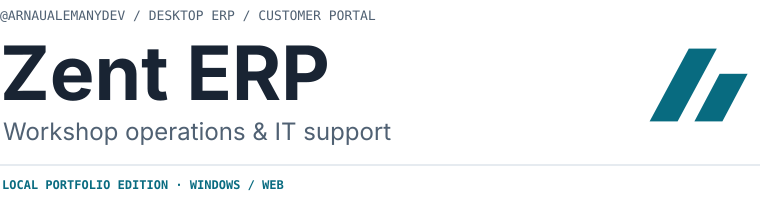
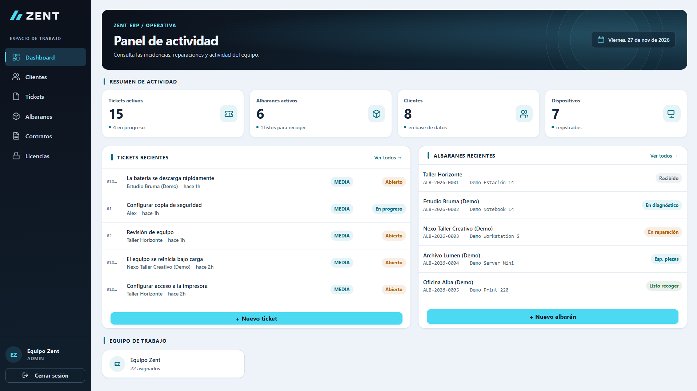
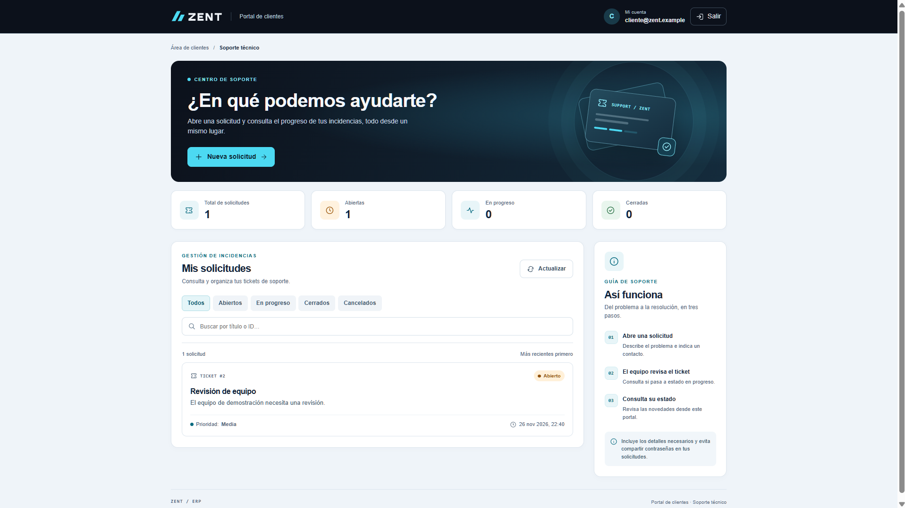
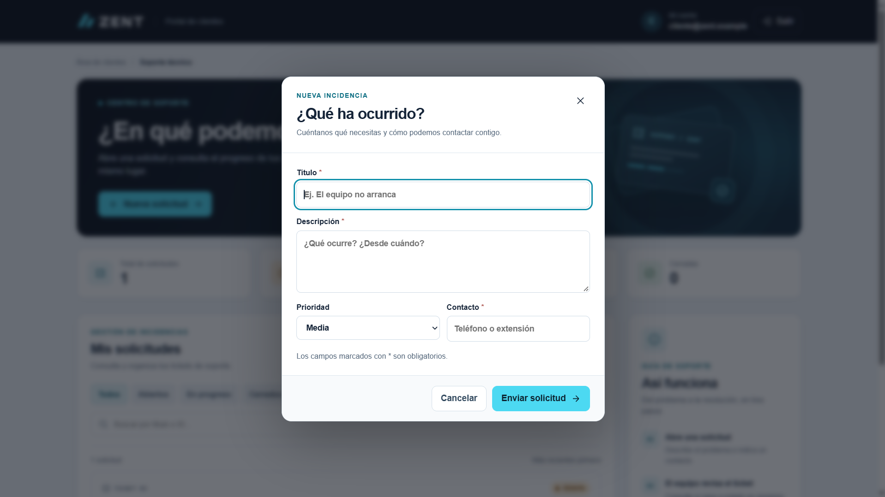
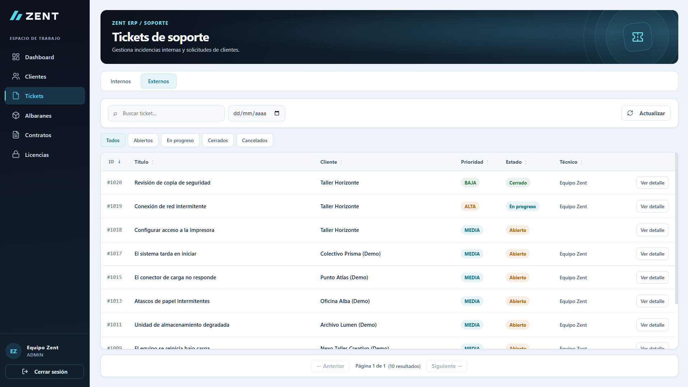
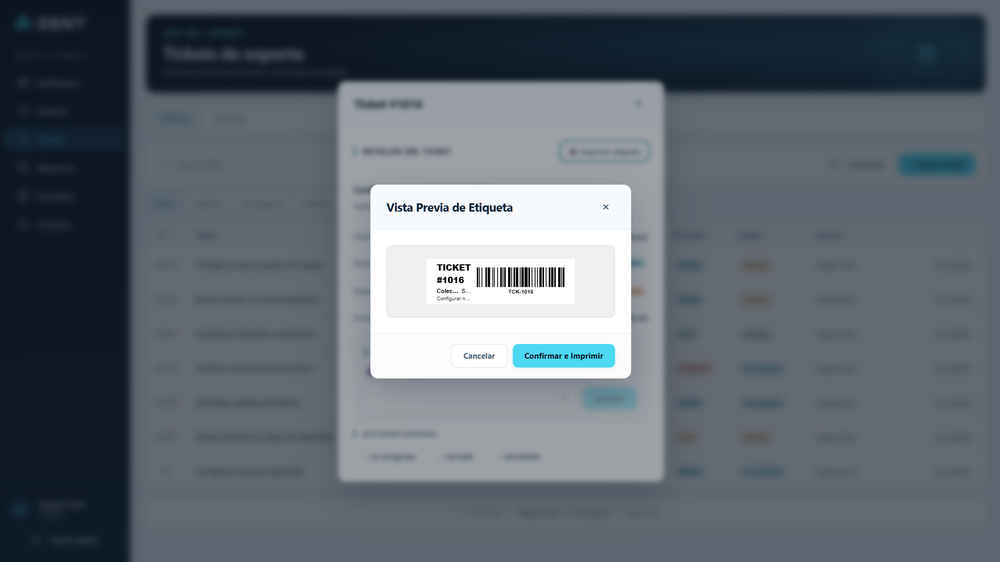
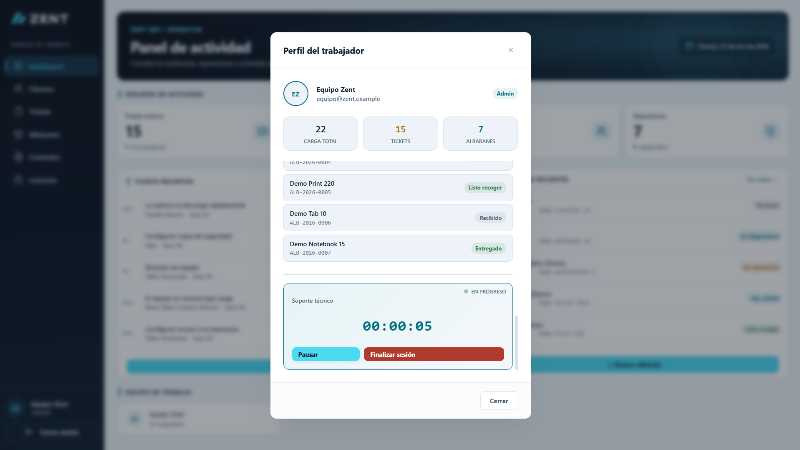
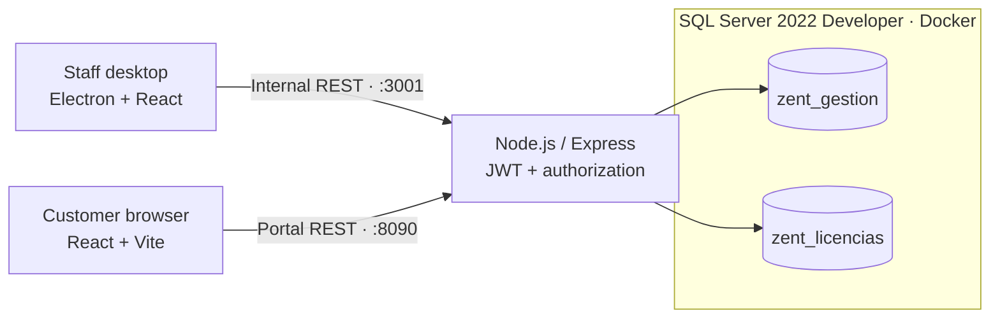

<p align="right"><b>EN</b> · <a href="README.es.md">ES</a></p>
<picture>
  <source media="(prefers-color-scheme: dark)" srcset="docs/readme/generated/header-en-dark.svg">
  
</picture>

**A desktop workspace for IT repair shops, connected to a customer-facing support portal.** Manage devices, repairs, incidents, service contracts and software inventory from one system.

[Explore the gallery](docs/gallery.md) · [Run locally](#06--run-locally) · [Security assessment](docs/security/assessment.md) · [Zent Web](https://github.com/ArnauAlemanyDev/Zent-Web)



<picture>
  <source media="(prefers-color-scheme: dark)" srcset="docs/readme/generated/metrics-en-dark.svg">
  
</picture>

## 01 / Project context

The original application was developed during my Multiplatform Application Development (DAM) work placement to address day-to-day needs observed in an IT service workshop. Tracking a computer from intake to collection, assigning incidents, identifying physical equipment and recording time spent on support calls were practical requirements, not just sample CRUD operations.

This portfolio edition uses the fictional Zent identity and synthetic records. Subsequent work focused on a cohesive interface, repeatable local setup, dependency modernization, security engineering and measurable bundle optimization. Both interfaces are in Spanish. The application is a local demonstration, not a hosted commercial service.

## 02 / Connected workflows

### Customer support, from request to resolution



A customer signs in, opens a support request with a description, priority and contact information, and checks its status. Staff review the request under **Tickets → Externos**, assign a technician and update its state; the customer can refresh the portal to see the change.

| Open a request | Manage the request |
| --- | --- |
| [](docs/screenshots/portal-new-ticket.webp) | [](docs/screenshots/external-tickets.webp) |

[View the customer's ticket statuses](docs/screenshots/portal-requests.webp) · [View the ticket detail](docs/screenshots/ticket-detail.webp)

### Workshop operations

| Capability | Practical purpose |
| --- | --- |
| Clients & devices | Individual and business records, linked devices, tickets and repairs. |
| Internal & external tickets | Priorities, status filters and staff assignment. |
| Repair work orders | Intake, reported fault, budget, technician and progress through collection. |
| Contracts | Service terms, amounts, renewal flags and expiry dates. |
| Software inventory | Windows and Office license records, stock and bulk file import. |
| Customer contact | Open a prefilled WhatsApp message in the external browser. |

### Beyond the lists

| Physical equipment tracking | Remote support time tracking |
| --- | --- |
| [](docs/screenshots/barcode-label.webp) | [](docs/screenshots/remote-timer.webp) |
| Generate labels for equipment received in the workshop. A React hook handles keyboard-emulating barcode readers. | Record time spent assisting customers by phone or remote connection, link it to a device and retain session history. The ERP does not itself control remote computers. |

[Repair details](docs/screenshots/work-order-detail.webp) · [Bulk license import](docs/screenshots/import-preview.webp) · [Support history](docs/screenshots/remote-history.webp) · [Full screenshot gallery](docs/gallery.md)

## 03 / System architecture



The portal is served by Express at `/portal/`. The listener on port 8090 only exposes portal routes, while the internal API listens on port 3001. SQL Server is published on loopback by default and persists data in a Docker volume.

| Layer | Technology |
| --- | --- |
| Desktop | Electron · React · Vite · React Router · Zustand |
| Customer portal | React · Vite · Zustand |
| API | Node.js · Express · JWT · bcryptjs · mssql |
| Persistence | SQL Server 2022 Developer · Docker Compose |
| Workshop tooling | React Barcode · SheetJS · NSIS |
| Verification | Node.js test runner · GitHub Actions · Dependabot |

## 04 / Security engineering

Security work was carried out against the local demo, with reproducible tests and explicit residual-risk documentation.

| Area | Controls |
| --- | --- |
| Authentication | bcrypt password hashing; HS256 token verification; bounded login rate limiting and credential validation. |
| API | Origin allowlists, security headers, no-store responses, parser and portal-ticket validation. |
| Authorization | Role separation, tenant isolation and current SQL account status checks before authenticated operations. |
| Electron | Context isolation, disabled renderer Node integration, sandbox, CSP, restricted navigation, permissions and IPC senders. |
| Configuration | Generated local secrets; dedicated SQL application account; loopback bindings. |
| Maintenance | Automated unit checks, dependency audits, builds and Dependabot configuration. |

| Local verification · 26 Nov 2026 | Passed |
| --- | ---: |
| Unit tests | 33 / 33 |
| HTTP checks | 22 / 22 |
| SQL/API integration checks | 9 / 9 |
| **Total** | **64 / 64** |

Run the unit suite without infrastructure:

```powershell
node scripts/test-security.mjs
```

With the local demo running, `node scripts/test-security.mjs --integration` also runs HTTP and SQL checks. Integration creates temporary synthetic fixtures and may leave audit records. Do not use it against real customer data.

The last observed full npm audit dropped from 59 aggregate findings to six moderate packaging-toolchain findings (not necessarily distinct vulnerabilities); no high or critical findings were reported. The hosted CI configuration has not yet been verified. See [SECURITY.md](SECURITY.md) and the [technical assessment](docs/security/assessment.md) for scope and residual risks, including local HTTP, session reactivation, opaque Electron origins and the unsigned installer. This is not a security certification or a production-readiness claim.

## 05 / Performance

SheetJS is loaded on demand when processing Excel files rather than as part of the initial renderer bundle.

| Vite production build | Before | After |
| --- | ---: | ---: |
| Initial JS | 808.34 kB | 452.58 kB |
| Initial JS (gzip) | 246.71 kB | 126.05 kB |
| Chunk-size warnings | 1 | 0 |

**44% smaller initial JavaScript bundle.** The separate SheetJS chunk is 488.37 kB. This reduces initial bundle weight, not total downloaded code when all features are used; actual startup latency was not benchmarked. Synthetic license import was observed working after the change.

## 06 / Run locally

> [!IMPORTANT]
> Designed for local demonstration with synthetic data. Use a fresh directory, generated secrets and a separate Docker volume. Do not expose this installation to the Internet.

**Requirements:** Windows x64, Node.js 24, npm and Docker Desktop running Linux containers. From the repository root in PowerShell:

```powershell
node scripts/configurar.mjs
docker compose up -d --wait
npm ci --prefix backend
npm ci --prefix frontend
npm ci --prefix portal
npm run build --prefix portal
npm run db:init --prefix backend
# Optional: add 41 synthetic showcase records
node backend/scripts/seed-showcase.js --apply
```

Start the backend in one terminal:

```powershell
npm start --prefix backend
```

Start the desktop in another:

```powershell
npm run electron:dev --prefix frontend
```

| Interface | Address / demo account | Local password variable |
| --- | --- | --- |
| Desktop | `equipo@zent.example` | `DEMO_EQUIPO` |
| [Customer portal](http://localhost:8090/portal/) | `cliente@zent.example` | `DEMO_PORTAL` |
| [Health endpoint](http://localhost:3001/api/v1/health) | `GET` | — |

Passwords are randomly generated in the local `.env`; do not commit or share it. The SQL port defaults to 1433; if occupied, set `DB_PORT` in `.env` before starting Docker. Stop the desktop and backend before running `docker compose stop` to preserve the data volume.

<details>
<summary><b>Build the Windows desktop installer</b></summary>

```powershell
npm run electron:build --prefix frontend -- --win --publish never
```

The NSIS installer is generated under `frontend/dist-electron/`. It is unsigned and packages only the desktop client; the API, compiled portal and SQL Server must be started separately. The Windows build and unpacked executable were verified locally; a clean installer installation is not claimed. There is no public installer or hosted demo.

</details>

## 07 / Repository & validation

```text
frontend/     Electron shell and React desktop
portal/       Customer support web interface
backend/      REST API, database initialization and tests
database/     SQL schemas and synthetic fixtures
scripts/      Local setup and security test runner
docs/         Product gallery and security assessment
.github/      Security/build workflow and Dependabot
```

Local evidence includes the packaged application, portal, SQL authorization checks, successful license import, external WhatsApp navigation and label preview. Physical label printing, scanner hardware, clipboard and complete timer regression remain unverified. The final redesigned portal sign-in still requires a real authentication retest. See the [security assessment](docs/security/assessment.md) for the dated test scope.

## 08 / Related projects

**[Zent Web](https://github.com/ArnauAlemanyDev/Zent-Web)** — responsive corporate website for the same fictional IT consultancy. The two repositories share a visual identity but are separate applications.

Developed by **[Arnau Alemany](https://github.com/ArnauAlemanyDev)** · DAM graduate / cybersecurity student.
